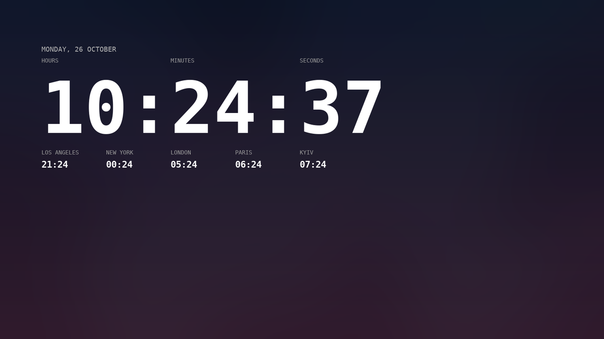

# Desktop Clock widget

A frameless, transparent digital clock that lives **on your Windows desktop** — behind
your windows, above your wallpaper, with no title bar and no taskbar button.



```
   MONDAY, 26 OCTOBER
   HOURS   MINUTES   SECONDS
    10  :   24   :     37
   LOS ANGELES   NEW YORK   LONDON   PARIS   KYIV
     21:24        00:24     05:24   06:24   07:24
```

Pure Python + Tkinter: no third-party runtime dependencies, no admin rights, no installer.
Single `.exe`, ~12 MB.

---

## Get the EXE

**Option A — download the prebuilt binary**

1. Grab `DesktopClock.exe` from the [latest release](../../releases/latest) — direct link:
   [`releases/latest/download/DesktopClock.exe`](../../releases/latest/download/DesktopClock.exe).
2. Or open the [Actions tab](../../actions/workflows/build-windows-exe.yml), pick the newest
   green *Build Windows EXE* run and download the **DesktopClock-windows-x64** artifact.
3. Put `DesktopClock.exe` anywhere you like and double-click it.

The build runs on `windows-latest` with PyInstaller, so the file is a genuine
Windows executable (no console window).

**Option B — build it yourself**

```bat
build_exe.bat
```

Needs Python 3.9+ from python.org (the Microsoft Store build cannot be used with
PyInstaller). The script creates a venv, installs PyInstaller, and writes
`dist\DesktopClock.exe`.

---

## Using it

| Action | What happens |
| --- | --- |
| **Left-drag** anywhere on the clock | move it (position is remembered) |
| **Right-click** | menu: settings file, reload, seconds on/off, 24-hour clock, world clocks, stay-on-desktop, close |
| `Esc`-free | there is no title bar, so close from the right-click menu |

The clock is pinned just above the wallpaper, so `Win + D` / *Show desktop* will not
hide it, and a full-screen window will cover it — it behaves like part of the wallpaper.

**Autostart with Windows:** `Win + R` → `shell:startup` → put a shortcut to
`DesktopClock.exe` in that folder.

---

## Settings

Everything is one JSON file, created on first run:

```
%APPDATA%\DesktopClock\config.json
```

Open it from the right-click menu (*Edit settings file*), change values, then
*Reload settings*. Nothing needs recompiling.

| Key | Default | Meaning |
| --- | --- | --- |
| `font_family` | `"Consolas"` | any installed font; monospace looks best (`"Cascadia Mono"`, `"JetBrains Mono"`, `"Fira Code"`) |
| `digit_size` | `150` | height of the big digits in pixels (DPI-independent) |
| `caption_size` / `world_size` / `date_size` | `13` / `20` / `16` | text sizes |
| `gap` | `10` | vertical space between rows |
| `text_color` | `"#FFFFFF"` | use `"#000000"` on a light wallpaper |
| `caption_color` / `date_color` | `"#9C9C9C"` / `"#B4B4B4"` | label colours |
| `transparent_color` | `"#010101"` | chroma-key colour, becomes invisible — never use it for text |
| `show_captions` | `true` | the *hours / minutes / seconds* row |
| `show_seconds` | `true` | show the seconds block |
| `show_date` | `true` | date line above the clock |
| `date_format` | `"%A, %d %B"` | any `strftime` pattern, `""` hides it |
| `show_world_clocks` | `true` | the city row |
| `world_clocks` | 5 cities | `[["Label", "IANA/Timezone"], ...]` — see the [tz database list](https://en.wikipedia.org/wiki/List_of_tz_database_time_zones) |
| `clock_24h` | `true` | `false` for AM/PM style hours |
| `keep_on_desktop` | `true` | `false` = a normal window floating above other windows |
| `behind_icons` | `false` | `true` = sink *under* the desktop icons (they overlap the clock) |
| `position` | `null` | `[x, y]`, maintained automatically |

Example — big black clock for a light wallpaper, one world clock:

```json
{
  "text_color": "#000000",
  "caption_color": "#5A5A5A",
  "date_color": "#3C3C3C",
  "digit_size": 220,
  "world_clocks": [["Tokyo", "Asia/Tokyo"]]
}
```

---

## How it works

* `overrideredirect(True)` removes the frame; `-transparentcolor #010101` makes that exact
  shade fully see-through, so only the glyphs remain.
* The window is pushed to the **bottom of the top-level z-order** (`HWND_BOTTOM`), so it
  sits above the wallpaper and under every normal window, and it is re-asserted every ~3 s
  (and after each drag) because Explorer and window activation keep rearranging things.
  Setting `behind_icons: true` instead re-parents it onto the **WorkerW** window, i.e.
  underneath the desktop icons.
* It also carries `WS_EX_TOOLWINDOW`, so it never appears in the taskbar or Alt+Tab.
* Redraws are aligned to the next second boundary instead of a fixed 200 ms timer, so the
  seconds change exactly when your system clock does.
* `zoneinfo` + the bundled `tzdata` package means world clocks work on Windows, which
  ships without an IANA timezone database.

## Files

```
clock_widget.py                        the whole app (~450 lines)
build_exe.bat                          local one-click build
requirements.txt                       tzdata (bundled into the exe)
.github/workflows/build-windows-exe.yml  builds + uploads the exe on every push
assets/icon.ico, assets/icon.png       app icon
```

## Notes / limitations

* Windows only for the desktop-pinning and transparency tricks; on Linux/macOS the
  window still runs, but without chroma-key transparency.
* If *Show desktop icons* is off, Explorer may not create the WorkerW window; the app then
  falls back to bottom-of-z-order placement (still visible, still covered by windows).
* Tray icon: not included — the widget is meant to be forgotten about. Close it from the
  right-click menu.
